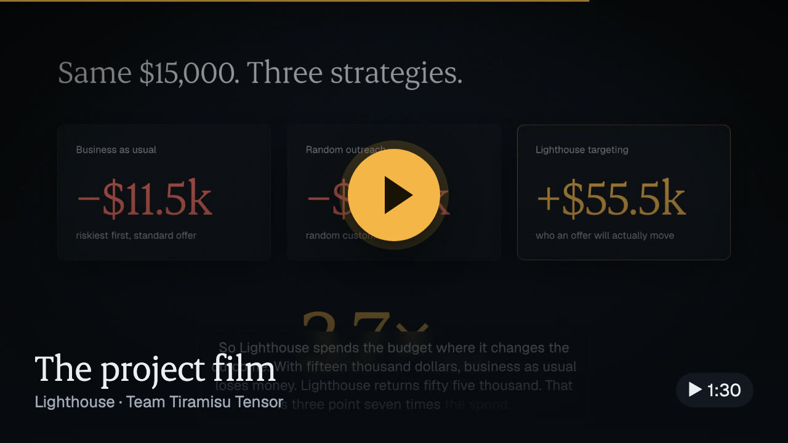
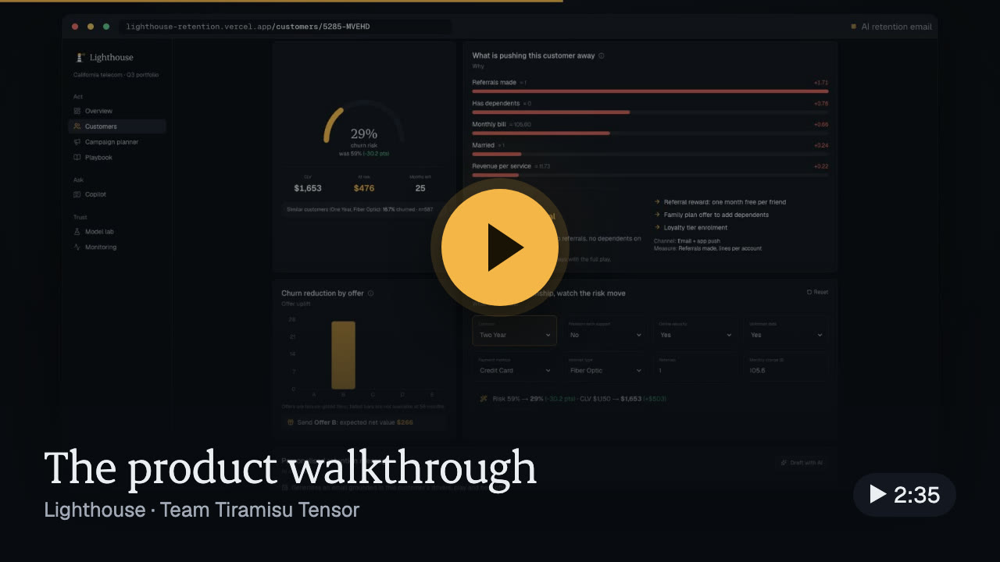
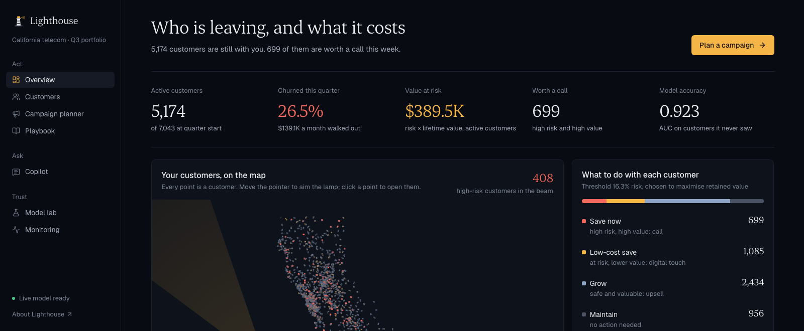
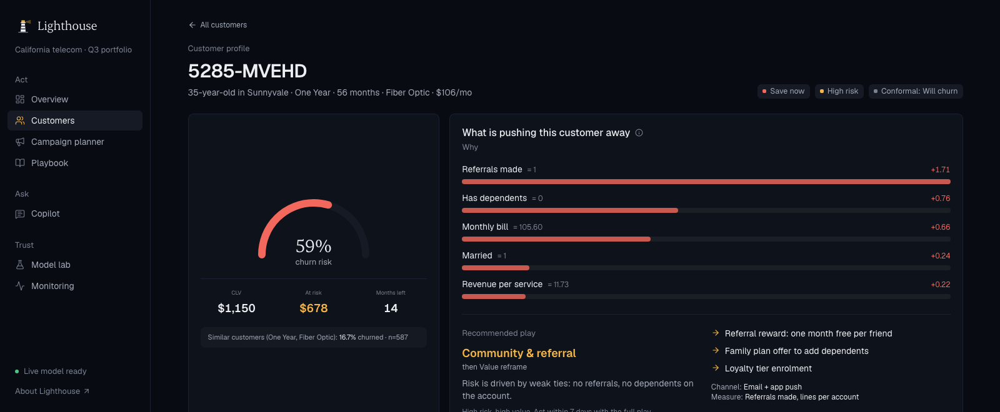
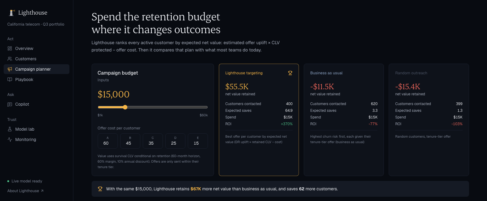
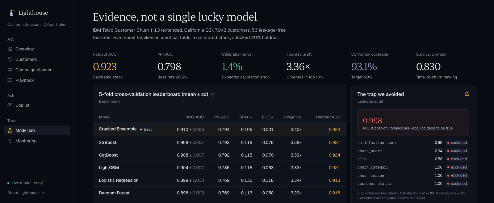
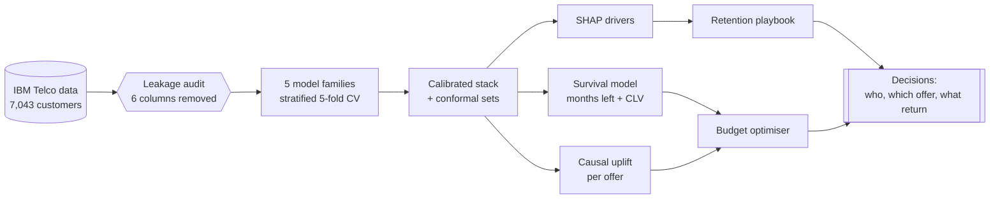
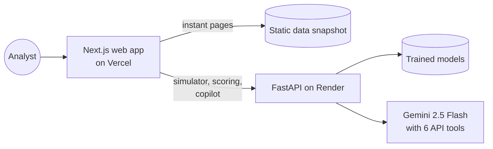

<div align="center">

<a href="https://lighthouse-retention.vercel.app"></a>

<h1>Lighthouse</h1>

<h3>See who is about to leave, what each customer is worth,<br>and the offer that will actually keep them.</h3>

<p>
<a href="https://lighthouse-retention.vercel.app"></a>
<a href="https://lighthouse-retention.vercel.app/watch"></a>
<a href="https://lighthouse-retention.vercel.app/deck"></a>
<a href="https://deepwiki.com/ac265640/LightHouse"></a>
</p>

<p>


</p>

**[Live app](https://lighthouse-retention.vercel.app)** · **[Videos](https://lighthouse-retention.vercel.app/watch)** · **[API docs](https://lighthouse-api-9f2b.onrender.com/docs)** · **[Methodology](docs/methodology.md)** · **[Pitch deck](https://lighthouse-retention.vercel.app/deck)**

*Team Tiramisu Tensor · DataNova 2026 Global Data-thon · DN-BU-01: Customer Churn Prediction and Retention Strategy*

</div>

<br>

> [!TIP]
> **Try it in 60 seconds.** Open the [live app](https://lighthouse-retention.vercel.app) and move your mouse over the map to aim the lamp. Then open [customer 5285-MVEHD](https://lighthouse-retention.vercel.app/customers/5285-MVEHD), change their contract to **Two Year** in the what-if simulator, and watch the live model drop their churn risk from 59% to 29%.

## Watch

<table>
<tr>
<td width="50%"><a href="https://lighthouse-retention.vercel.app/watch#film"></a></td>
<td width="50%"><a href="https://lighthouse-retention.vercel.app/watch#demo"></a></td>
</tr>
<tr>
<td><b>The project film</b> (1 min 30 s). Covers the problem, the leakage trap, the models, survival lifetime value, the causal twist on offers, the money and the product. <a href="https://lighthouse-retention.vercel.app/videos/lighthouse-film.mp4">Open the video file</a></td>
<td><b>The product walkthrough</b> (2 min 35 s). Every page of the live app, with the real model answering: the map, profiles, the what-if simulator, AI emails, campaigns and the copilot. <a href="https://lighthouse-retention.vercel.app/videos/lighthouse-demo.mp4">Open the video file</a></td>
</tr>
</table>

## At a glance

<table>
<tr>
<td align="center" width="25%"><h2>0.923</h2>ROC-AUC on a locked holdout<br><sub>leak-free. A leaky model scores 0.998</sub></td>
<td align="center" width="25%"><h2>1.4%</h2>calibration error<br><sub>a 30% score means 30 in 100 leave</sub></td>
<td align="center" width="25%"><h2>0.83</h2>survival c-index<br><sub>months left and lifetime value</sub></td>
<td align="center" width="25%"><h2>3.7×</h2>campaign ROI<br><sub>vs. a loss for business as usual</sub></td>
</tr>
</table>

## Why Lighthouse

Last quarter this California telecom lost **1,869 of its 7,043 customers**, and **$139k of monthly revenue** went with them. A churn score alone doesn't tell a retention team what to do. Lighthouse answers the three questions that do:

| The question | How Lighthouse answers it | What you see |
|---|---|---|
| **Who is leaving, and why?** | Five model families, stacked and calibrated, with SHAP drivers for every customer | A risk score you can trust, and the top five reasons behind it |
| **When, and what are they worth?** | A left-truncated Cox survival model and survival-weighted lifetime value | Months left, value if kept and value at risk |
| **Which offer will change their mind?** | Doubly-robust causal uplift per offer, plus a budget optimiser | Who to contact, with which offer, and the expected return |

On a **$15,000** budget, sending the standard offer to the riskiest customers **loses $11.5k**. Lighthouse spends the same money and **returns +$55.5k**.

## What's inside

| | Feature | What it does |
|---|---|---|
| 🗺️ | **[Live customer map](https://lighthouse-retention.vercel.app)** | Plots all 7,043 customers at their real locations, with a lamp you aim at them to light up who is at risk |
| 📊 | **[Overview](https://lighthouse-retention.vercel.app/overview)** | Portfolio KPIs, the priority mix, churn by contract and tenure, and this week's call list |
| 👤 | **[Customer profile](https://lighthouse-retention.vercel.app/customers/5285-MVEHD)** | Risk gauge, months left, lifetime value, SHAP drivers, the recommended play and uplift for each offer |
| 🎛️ | **What-if simulator** | Re-scores a customer live after you change their contract, services, payment or bill |
| ✉️ | **AI retention email** | Gemini drafts a personal email built on that customer's own drivers |
| 🎯 | **[Campaign planner](https://lighthouse-retention.vercel.app/campaign)** | Splits a budget three ways, compares strategies, sizes an A/B test and exports the call list |
| 📘 | **[Playbook](https://lighthouse-retention.vercel.app/playbook)** | Seven driver-based plays, each with actions, a channel and a KPI |
| 💬 | **[Copilot](https://lighthouse-retention.vercel.app/copilot)** | Answers questions by calling Lighthouse's own API, and shows which tools it used |
| 🔬 | **[Model lab](https://lighthouse-retention.vercel.app/model)** | Leaderboard, leakage audit, calibration, survival hazards and the fairness audit |
| 📈 | **[Monitoring](https://lighthouse-retention.vercel.app/monitoring)** | Drift checks (PSI) per feature, and scoring for a CSV of new customers |

## The product

<table>
<tr>
<td width="50%"><br><b>Overview</b>: KPIs, the customer map and who to call this week</td>
<td width="50%"><br><b>Customer profile</b>: risk, value, drivers, the play and the what-if simulator</td>
</tr>
<tr>
<td width="50%"><br><b>Campaign planner</b>: one budget, three strategies, an A/B test size</td>
<td width="50%"><br><b>Model lab</b>: leaderboard, holdout metrics and the leakage trap it avoided</td>
</tr>
</table>

## How it works

### The pipeline



1. **Trust the data.** Every column is scored on its own. Six of them are only recorded after a customer leaves: churn reason, category, status, satisfaction, the vendor's churn score and its CLTV. Left in, they give a misleading **0.998** AUC, so all six are removed. Gender is kept out of the model and used only for the fairness audit.
2. **Who will leave.** Logistic regression, random forest, XGBoost, LightGBM and CatBoost compete under stratified cross-validation. A logistic meta-learner stacks them, isotonic regression calibrates the result, and conformal prediction flags customers the model is unsure about.
3. **Why.** Exact TreeSHAP values give each customer's top five risk drivers.
4. **When, and how much.** The data is a one-quarter snapshot, so the Cox model uses **left truncation** and a custom Breslow baseline. The result is months left and a survival-weighted lifetime value for every customer.
5. **What works.** Offers here are tied to tenure tiers. A cross-fitted **doubly-robust** learner estimates each offer's effect inside its own tier, and for each customer.
6. **Decide.** A budget optimiser ranks customers by churn prevented × lifetime value − offer cost, and sizes an A/B test so every campaign can be confirmed.

### The system



Every page loads from a pre-exported snapshot, so it never waits on the API. Only the live features call the model. The whole setup runs on free tiers. See [docs/deployment.md](docs/deployment.md).

## Key findings

> [!IMPORTANT]
> **The leakage trap.** This dataset ships with columns written after customers leave. A model that keeps them scores 0.998 AUC and is useless on day one. With them removed, Lighthouse scores **0.923** on 1,409 customers it never saw.

> [!WARNING]
> **The offer that looked best did nothing.** A plain comparison says Offer A cuts churn by **20 points**. But Offer A only goes to customers past 66 months, who rarely leave anyway. Compared fairly inside its tenure tier, the effect is **+1.6 points**, with an interval that crosses zero. No offer works on average. The value is in choosing who receives it.

> [!NOTE]
> **Scores mean what they say.** Calibration error is 1.4%, so when Lighthouse says 30%, about 30 in 100 of those customers really leave. Conformal prediction flags the 24% it is unsure about instead of faking confidence.

> [!TIP]
> **Targeting beats spending.** With the same $15,000, business as usual loses $11.5k and random outreach loses $15.4k. Lighthouse returns **+$55.5k**, a 3.7× ROI.

<details>
<summary><b>Full model results</b></summary>
<br>

Five-fold cross-validation on 80% of customers, then a single score on a locked 20% holdout.

| Model | CV ROC-AUC | CV PR-AUC | Brier |
|---|---|---|---|
| **Stacked ensemble (calibrated)** | **0.910 ± 0.008** | **0.794** | **0.106** |
| XGBoost | 0.908 ± 0.007 | 0.792 | 0.118 |
| CatBoost | 0.908 ± 0.007 | 0.792 | 0.115 |
| LightGBM | 0.904 ± 0.007 | 0.785 | 0.115 |
| Logistic regression | 0.899 ± 0.010 | 0.769 | 0.135 |
| Random forest | 0.898 ± 0.009 | 0.769 | 0.114 |

| Holdout metric | Value |
|---|---|
| ROC-AUC | 0.923 |
| PR-AUC | 0.798 |
| Expected calibration error | 1.4% |
| Lift in the top risk decile | 3.36× |
| Conformal coverage (target 90%) | 93.1% |
| Survival c-index | 0.830 |
| Quarterly churn AUC from survival alone | 0.897 |

</details>

<details>
<summary><b>Offer effects: naive vs causal</b></summary>
<br>

| Offer | Tenure window | Naive effect | Causal effect (95% CI) |
|---|---|---|---|
| A | 66–72 months | −20.4 pts | +1.6 (−1.0, +4.2) |
| B | 40–65 months | −14.9 pts | −2.3 (−5.1, +0.6) |
| C | 24–39 months | −4.2 pts | −0.4 (−4.6, +3.7) |
| D | 10–23 months | −0.4 pts | −2.8 (−6.8, +1.3) |
| E | 1–10 months | +25.8 pts | +2.6 (−1.1, +6.4) |

Negative means fewer customers leave.

</details>

<details>
<summary><b>Campaign value on a $15,000 budget</b></summary>
<br>

| Strategy | Customers | Expected saves | Net value | ROI |
|---|---|---|---|---|
| **Lighthouse uplift targeting** | 400 | 64.9 | **+$55.5k** | **3.7×** |
| Business as usual (riskiest first, standard offer) | 620 | 3.3 | −$11.5k | −0.77× |
| Random outreach | 399 | 1.3 | −$15.4k | −1.03× |

</details>

## Tech stack

| Layer | Tools |
|---|---|
| **Modelling** |        |
| **API** |    |
| **AI** | , with function calling over 6 read-only tools |
| **Web** |       |
| **Quality** |   |
| **Hosting** |    |

## Repository structure

```text
lighthouse/
├── ml/retention/          Modelling library
│   ├── data.py              loading, cleaning, feature engineering, leakage audit
│   ├── models.py            model zoo, cross-validation, stacking, calibration, conformal
│   ├── survival.py          left-truncated Cox model, conditional survival, lifetime value
│   ├── uplift.py            doubly-robust offer effects and best-offer choice
│   ├── insights.py          SHAP drivers, fairness audit, drift (PSI)
│   └── pipeline.py          end-to-end training: writes artifacts/
├── backend/app/           API service
│   ├── main.py              18 endpoints: portfolio, customers, simulator, campaigns, scoring
│   ├── ai.py                Gemini copilot, emails, executive brief, usage limits
│   ├── playbook.py          driver-based retention plays
│   └── store.py             loads the models once and scores new rows
├── frontend/src/          Next.js analyst workspace and landing page
├── scripts/               data download and the static snapshot export
├── deploy/                Dockerfiles, Render blueprint, Vercel deploy script
├── docs/                  methodology, API, deployment and design notes
├── presentation/          pitch deck: PowerPoint, PDF and an animated HTML version
└── artifacts/report.json  validation report behind every number in this README
```

## Getting started

**Requirements:** Python 3.11 and Node.js 20 or newer.

```bash
git clone https://github.com/ac265640/LightHouse.git && cd LightHouse

# 1. Train the models (about a minute)
python3.11 -m venv .venv && source .venv/bin/activate
pip install -r requirements.txt
./scripts/download_data.sh && python -m ml.retention.pipeline

# 2. Start the API (docs at http://localhost:8000/docs)
uvicorn backend.app.main:app --port 8000

# 3. Start the web app in a second terminal (http://localhost:3000)
cd frontend && npm install && npm run dev
```

> [!NOTE]
> To turn on the AI copilot, copy `backend/.env.example` to `backend/.env` and add a Gemini API key. Every other feature works without it. To use the exact validated models instead of retraining, download them from the [models-v1 release](https://github.com/ac265640/LightHouse/releases/tag/models-v1) into `artifacts/`.

<details>
<summary><b>Run everything in Docker</b></summary>
<br>

```bash
docker build -f deploy/Dockerfile -t lighthouse .
docker run -p 7860:7860 -e GEMINI_API_KEY=your-key lighthouse
```

Open http://localhost:7860.

</details>

<details>
<summary><b>Run the tests</b></summary>
<br>

```bash
pytest -q ml/tests backend/tests            # 30 tests
cd frontend && npm run lint && npx tsc --noEmit
```

The tests cover:
- leakage exclusion
- calibration and conformal coverage
- left-truncated survival
- uplift effects
- the campaign optimiser
- the playbook
- every API endpoint
- input validation
- the copilot's usage limits

</details>

## API

| Method | Endpoint | Purpose |
|---|---|---|
| `GET` | `/api/summary` | Portfolio KPIs, priority mix and the call list |
| `GET` | `/api/customers/{id}` | Full profile: risk, CLV, drivers, play and offer uplift |
| `POST` | `/api/simulate` | Re-score a customer after a what-if change |
| `POST` | `/api/campaign` | Optimise a budget across three strategies |
| `POST` | `/api/score` | Score a CSV of new customers, with a drift check |
| `POST` | `/api/ai/chat` | Ask the copilot a question |

All 18 endpoints are documented in [docs/api.md](docs/api.md) and on the [live OpenAPI page](https://lighthouse-api-9f2b.onrender.com/docs).

## Documentation

| Document | What's in it |
|---|---|
| [Methodology](docs/methodology.md) | Every modelling decision and the evidence behind it |
| [API reference](docs/api.md) | All endpoints, parameters, examples and usage limits |
| [Deployment](docs/deployment.md) | How the free Vercel and Render setup works, and how to redeploy |
| [Design](docs/design.md) | The colour, type and motion system |
| [Pitch deck](https://lighthouse-retention.vercel.app/deck) | The 15-slide pitch deck ([PowerPoint](presentation/Lighthouse-Team-Tiramisu-Tensor.pptx), [PDF](presentation/Lighthouse-Team-Tiramisu-Tensor.pdf)) with speaker notes |

## Limitations

- **One quarter, one company.** The models should be retrained on a client's own history before use.
- **Offer effects are observational.** None is significant on its own, so every campaign comes with an A/B test size.
- **Exit reasons can't be predicted from the profile.** A reason model scored 44% against a 45% baseline, so the plays use SHAP drivers instead.
- **Recall differs by group.** The fairness audit reports this openly in the Model lab.

## Roadmap

| Phase | What happens |
|---|---|
| **Weeks 1–2** | Score the CRM's nightly export through `/api/score`, with a drift check first |
| **Months 1–2** | Run the A/B tests the planner sizes, and retrain uplift on the experiment data |
| **Quarter 2** | Trigger plays from the CRM when a customer's risk crosses the threshold, with monthly drift reviews |

## Team

Built by **Team Tiramisu Tensor** for the **DataNova 2026 Global Data-thon** (Swiss School of Management × ACM Seattle), problem statement **DN-BU-01: Customer Churn Prediction and Retention Strategy**.

<details>
<summary><b>Credits</b></summary>
<br>

- **Dataset:** [IBM Telco Customer Churn 11.1.3](https://huggingface.co/datasets/aai510-group1/telco-customer-churn), 7,043 California customers.
- **Animated components:** some are adapted from [React Bits](https://github.com/DavidHDev/react-bits) (MIT + Commons Clause). Motion uses [GSAP](https://gsap.com) and [Lenis](https://github.com/darkroomengineering/lenis).
- **Voiceover:** both videos are narrated with [Kokoro](https://github.com/hexgrad/kokoro), an open-source voice model.
- **Landing photograph:** Joshua Hibbert (Unsplash licence).

</details>

---

## Chat with this repository

Have a question about the code? Ask an AI that has read the whole repository:

<p>
<a href="https://deepwiki.com/ac265640/LightHouse"></a>
&nbsp;
<a href="https://github.com/copilot"></a>
&nbsp;
<a href="https://lighthouse-retention.vercel.app/copilot"></a>
</p>

- **DeepWiki** explains the code, its architecture and how the pieces connect.
- **GitHub Copilot** answers questions about any file. Choose this repository after opening it.
- **The Lighthouse copilot** answers questions about the customers and the model, using live data.

<div align="center">
<br>
<sub>Made with care by Team Tiramisu Tensor · DataNova 2026</sub>
</div>
