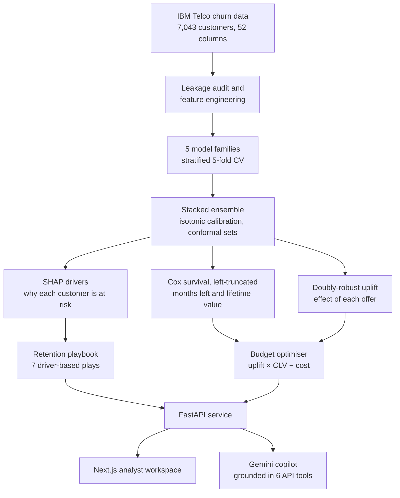

<div align="center">

# Lighthouse

**Churn prediction and causal retention planning for subscription businesses.**

See which customers are about to leave, what each one is worth, and the offer that will actually keep them.

[**Live demo**](https://lighthouse-retention.vercel.app) · [API docs](https://lighthouse-api-9f2b.onrender.com/docs) · [Methodology](docs/methodology.md) · [Pitch deck](presentation/lighthouse-deck.html)

Built for the **DataNova 2026 Global Data-thon**, problem statement **DN-BU-01: Customer Churn Prediction and Retention Strategy**.

</div>

---

## Contents

- [Why Lighthouse](#why-lighthouse)
- [Results](#results)
- [How it works](#how-it-works)
- [The product](#the-product)
- [Tech stack](#tech-stack)
- [Repository structure](#repository-structure)
- [Getting started](#getting-started)
- [API](#api)
- [Deployment](#deployment)
- [Testing](#testing)
- [Limitations](#limitations)
- [Data and credits](#data-and-credits)

## Why Lighthouse

Most churn projects stop at a high AUC. A retention team needs three more answers before it can act:

1. **Who is worth saving?** A risk score says nothing about value or timing.
2. **Will an offer change their mind?** The riskiest customers often leave whatever you send, and many others would have stayed anyway.
3. **Where should a fixed budget go?** Spending by risk alone can lose money.

Lighthouse answers all three. It predicts who will leave with a calibrated, leak-free model, estimates when they will leave and what they are worth with a survival model, measures which offers really work with causal inference, then spends a budget where it changes outcomes.

On a **$15,000** budget, sending the standard offer to the riskiest customers **loses $11.5k**. Lighthouse's targeting returns **$55.5k net, a 3.7× ROI**.

## Results

Every figure below is measured on a **locked 20% holdout (1,409 customers)** that no model saw during training.

### Who will leave

| Metric | Value |
|---|---|
| ROC-AUC | **0.923** |
| PR-AUC | 0.798 |
| Expected calibration error | **1.4%** |
| Brier score | 0.096 |
| Lift in the top risk decile | 3.36× |
| Conformal coverage (target 90%) | 93.1% |

Five model families were benchmarked with 5-fold stratified cross-validation, then stacked:

| Model | CV ROC-AUC | CV PR-AUC | Brier |
|---|---|---|---|
| **Stacked ensemble (calibrated)** | **0.910** | **0.794** | **0.106** |
| XGBoost | 0.908 | 0.792 | 0.118 |
| CatBoost | 0.908 | 0.792 | 0.115 |
| LightGBM | 0.904 | 0.785 | 0.115 |
| Logistic regression | 0.899 | 0.769 | 0.135 |
| Random forest | 0.898 | 0.769 | 0.114 |

### When they will leave, and what they are worth

| Metric | Value |
|---|---|
| Survival model c-index | 0.830 |
| Quarterly churn AUC implied by survival | 0.897 |
| Rank agreement with the classifier (Spearman) | 0.95 |

### What actually works

| Offer | Tenure window | Naive effect | Causal effect (95% CI) |
|---|---|---|---|
| A | 66–72 months | −20.4 pts | **+1.6** (−1.0, +4.2) |
| B | 40–65 months | −14.9 pts | −2.3 (−5.1, +0.6) |
| C | 24–39 months | −4.2 pts | −0.4 (−4.6, +3.7) |
| D | 10–23 months | −0.4 pts | −2.8 (−6.8, +1.3) |
| E | 1–10 months | +25.8 pts | +2.6 (−1.1, +6.4) |

Negative means fewer customers leave. A naive comparison credits Offer A with a 20-point cut in churn, but Offer A only reaches customers past 66 months, who rarely leave anyway. Compared fairly, no offer works on average, so the value lies in choosing who receives each one.

### Campaign value on a $15,000 budget

| Strategy | Customers contacted | Net value | ROI |
|---|---|---|---|
| **Lighthouse uplift targeting** | 400 | **+$55.5k** | **3.7×** |
| Business as usual (riskiest first, tier offer) | 620 | −$11.5k | −0.77× |
| Random outreach | 399 | −$15.4k | −1.03× |

## How it works



1. **Trust the data.** Every column is scored on its own against the label. Six columns that are recorded after a customer leaves (churn reason, churn category, customer status, satisfaction score, the vendor's churn score and CLTV) are removed. Left in, they give a misleading 0.998 AUC. Gender is excluded from the model and kept only for the fairness audit.
2. **Who will leave.** Logistic regression, random forest, XGBoost, LightGBM and CatBoost are compared with stratified cross-validation and paired bootstrap tests. A logistic meta-learner stacks their out-of-fold predictions, and isotonic regression calibrates the result. Mondrian conformal prediction flags customers the model is unsure about.
3. **Why.** Exact TreeSHAP values give the top five reasons each customer is at risk.
4. **When, and how much.** The data is a single-quarter snapshot, so a Cox model with left truncation and a custom Breslow baseline estimates the remaining months for each customer. That curve gives a survival-based lifetime value, at a 60% margin and 10% discount over five years.
5. **What works.** Offers in this data are tied to tenure tiers, so a cross-fitted doubly-robust learner estimates each offer's effect inside its own tenure window, plus a per-customer effect.
6. **Decide.** A greedy optimiser ranks customers by expected churn prevented × lifetime value − offer cost, and spends the budget top-down. Every campaign comes with an A/B test sample size so effects can be confirmed.

The full write-up, with every design decision and its evidence, is in [docs/methodology.md](docs/methodology.md).

## The product

| Page | What an analyst does there |
|---|---|
| **Landing** | Watches a lamp sweep a map of all 7,043 customers at their real locations, lighting risk as it passes |
| **Overview** | Reads the portfolio's KPIs, the priority mix and the call list for this week |
| **Customers** | Searches, filters and sorts every customer by risk, value or play |
| **Customer profile** | Sees risk, months left, lifetime value and SHAP drivers. Tries changes in a what-if simulator, and drafts a retention email with AI |
| **Campaign planner** | Sets a budget and offer costs, compares three strategies, sizes an A/B test and exports the call list |
| **Playbook** | Reviews seven plays, each with actions, a channel and a KPI, sized by at-risk value |
| **Copilot** | Asks questions in plain English. Gemini answers by calling Lighthouse's own API and shows which tools it used |
| **Model lab** | Inspects the leaderboard, calibration, survival hazards, the leakage audit and the fairness audit |
| **Monitoring** | Checks feature drift (PSI) and scores a CSV of new customers, with a drift check first |

## Tech stack

| Layer | Tools |
|---|---|
| Modelling | Python 3.11, scikit-learn, XGBoost, LightGBM, CatBoost, lifelines, pandas, NumPy, SciPy |
| API | FastAPI, Pydantic, Uvicorn |
| AI | Google Gemini 2.5 Flash with automatic function calling |
| Web | Next.js 15, React 19, TypeScript, Tailwind CSS 4, Recharts, GSAP, Lenis |
| Testing | pytest (30 tests across the models and the API), ESLint, TypeScript |
| Hosting | Vercel (web), Render (API), Docker |

## Repository structure

```text
lighthouse/
├── ml/                          Modelling library
│   ├── retention/
│   │   ├── data.py              Loading, cleaning, feature engineering, leakage audit
│   │   ├── models.py            Model zoo, cross-validation, stacking, calibration, conformal
│   │   ├── survival.py          Left-truncated Cox model, conditional survival, CLV
│   │   ├── uplift.py            Doubly-robust offer effects and best-offer choice
│   │   ├── insights.py          SHAP drivers, reason model, fairness audit, drift (PSI)
│   │   └── pipeline.py          End-to-end training: writes everything in artifacts/
│   └── tests/                   Model tests
├── backend/                     API service
│   ├── app/
│   │   ├── main.py              REST endpoints: portfolio, customers, simulator, campaigns, scoring
│   │   ├── ai.py                Gemini copilot, retention emails, executive brief, usage limits
│   │   ├── playbook.py          Driver-based retention plays
│   │   └── store.py             Loads artifacts once and scores new rows
│   └── tests/                   API tests
├── frontend/                    Next.js analyst workspace
│   └── src/
│       ├── app/(site)/          Landing page
│       ├── app/(app)/           Workspace pages: overview, customers, campaign, playbook, copilot, model, monitoring
│       ├── components/          Shell, UI kit, motion, coastline map, landing sections
│       └── lib/                 API client (live or static snapshot), formatting, data hooks
├── artifacts/report.json        Validation report behind every number in this README
├── scripts/
│   ├── download_data.sh         Fetches the dataset
│   └── export_snapshot.py       Exports read-only API data as static JSON for hosting
├── docs/                        Methodology, API, deployment and design notes
├── presentation/                Pitch deck (open the HTML file in a browser)
├── deploy/deploy_web.sh         Builds and deploys the web app to Vercel
├── Dockerfile                   Web app and API in one container
├── Dockerfile.api               API only, sized for a 512 MB instance
├── render.yaml                  Render blueprint for the API
├── requirements.txt             Python dependencies for training and tests
└── requirements-api.txt         Slimmer runtime dependencies for the API
```

## Getting started

**Requirements:** Python 3.11, Node.js 20 or newer.

```bash
git clone https://github.com/ac265640/LightHouse.git
cd LightHouse
```

**1. Train the models** (about a minute)

```bash
python3.11 -m venv .venv && source .venv/bin/activate
pip install -r requirements.txt
./scripts/download_data.sh
python -m ml.retention.pipeline
```

This writes `artifacts/model.joblib`, `artifacts/customers_scored.parquet` and `artifacts/report.json`. To use the exact validated models instead, download them from the [models-v1 release](https://github.com/ac265640/LightHouse/releases/tag/models-v1) into `artifacts/`.

**2. Start the API**

```bash
uvicorn backend.app.main:app --port 8000
```

Interactive docs are at http://localhost:8000/docs. To turn on the copilot, create `backend/.env` from `backend/.env.example` and add a Gemini API key. Every other feature works without it.

**3. Start the web app**

```bash
cd frontend
npm install
npm run dev
```

Open http://localhost:3000.

**Or run everything in Docker**

```bash
docker build -t lighthouse .
docker run -p 7860:7860 -e GEMINI_API_KEY=your-key lighthouse
```

## API

The API serves 18 endpoints. The main ones:

| Method | Endpoint | Purpose |
|---|---|---|
| GET | `/api/summary` | Portfolio KPIs, priority mix, churn by contract and tenure, call list |
| GET | `/api/customers` | Search, filter, sort and page customers |
| GET | `/api/customers/{id}` | Full profile: risk, CLV, drivers, play, offer uplift |
| POST | `/api/simulate` | What-if: re-score a customer after changing their plan |
| POST | `/api/campaign` | Optimise a budget across three strategies |
| GET | `/api/abtest` | Sample size to confirm an offer's effect |
| POST | `/api/score` | Score a CSV of new customers, with a drift check |
| POST | `/api/ai/chat` | Ask the copilot a question |

The full reference is in [docs/api.md](docs/api.md), and the live service publishes an OpenAPI page at [/docs](https://lighthouse-api-9f2b.onrender.com/docs).

## Deployment

The live demo runs entirely on free tiers:

- **Web app on Vercel.** Read-only data is exported as static JSON, so every page loads instantly and never waits on the API.
- **API on Render.** It serves only the live features: the simulator, CSV scoring, custom-cost campaigns and the copilot. The free instance sleeps after 15 minutes idle and takes about a minute to wake.
- **Copilot usage** is capped per visitor, per minute and per day, so a public demo stays inside Gemini's free quota.

Step-by-step instructions are in [docs/deployment.md](docs/deployment.md).

## Testing

```bash
pytest -q ml/tests backend/tests     # 30 tests
cd frontend && npm run lint && npx tsc --noEmit
```

The tests cover:
- leakage exclusion
- calibration and conformal coverage
- left-truncated survival
- uplift effects
- the campaign optimiser
- the playbook
- every API endpoint
- input validation
- the copilot's usage limits

## Limitations

- **The data is one quarter from one company.** The models should be retrained on a client's own history before use.
- **Offer effects are observational.** They come from a doubly-robust design inside tenure tiers, and none is statistically significant on its own. That is why every campaign ships with an A/B test sample size.
- **Exit reasons are not predictable from the profile.** A reason classifier scored 44% against a 45% majority baseline. The plays therefore use SHAP drivers, and a short pulse survey is recommended to capture reasons earlier.
- **The fairness audit shows recall gaps by group.** The model catches more female and senior churners than male and non-senior ones. The gaps are reported in the Model lab rather than hidden.

## Data and credits

- **Dataset:** IBM Telco Customer Churn 11.1.3 (extended), 7,043 California customers. Fetched from the [Hugging Face mirror](https://huggingface.co/datasets/aai510-group1/telco-customer-churn) by `scripts/download_data.sh`.
- **UI components:** some animated components are adapted from [React Bits](https://github.com/DavidHDev/react-bits) (MIT + Commons Clause). Motion uses [GSAP](https://gsap.com) and [Lenis](https://github.com/darkroomengineering/lenis).
- **Photograph** on the landing page: Joshua Hibbert, Unsplash licence.

---

<div align="center">

Built by **Amit Singh Chauhan** for DataNova 2026.

</div>
