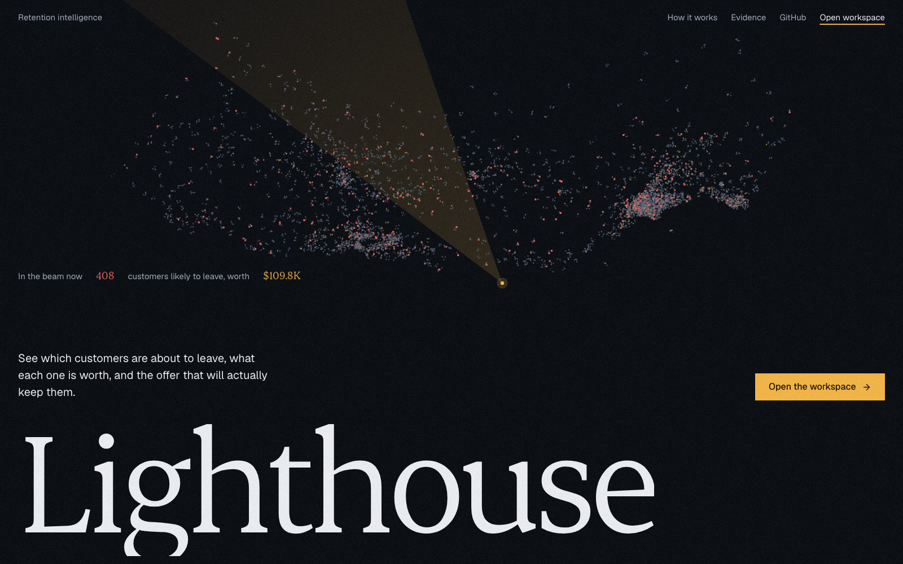
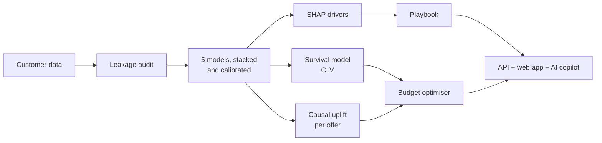

<div align="center">



# Lighthouse

### See who is about to leave, what each customer is worth, and the offer that will actually keep them.

[](https://lighthouse-retention.vercel.app)


**[Live demo](https://lighthouse-retention.vercel.app)** · **[API docs](https://lighthouse-api-9f2b.onrender.com/docs)** · **[Methodology](docs/methodology.md)** · **[Pitch deck](presentation/lighthouse-deck.html)**

*DataNova 2026 Global Data-thon · DN-BU-01: Customer Churn Prediction and Retention Strategy*

</div>

<br>

## At a glance

<table>
<tr>
<td align="center" width="25%"><h2>0.923</h2>ROC-AUC on a locked holdout<br><sub>leak-free; a leaky model scores 0.998</sub></td>
<td align="center" width="25%"><h2>1.4%</h2>calibration error<br><sub>a 30% score means 30 in 100 leave</sub></td>
<td align="center" width="25%"><h2>0.83</h2>survival c-index<br><sub>months left and lifetime value</sub></td>
<td align="center" width="25%"><h2>3.7×</h2>campaign ROI<br><sub>vs. a loss for business as usual</sub></td>
</tr>
</table>

## The problem

A churn score alone doesn't tell a retention team what to do. Lighthouse answers the three questions that do:

| Question | How Lighthouse answers it |
|---|---|
| **Who is leaving, and why?** | A stacked, calibrated ensemble of five model families, with SHAP drivers for every customer |
| **When, and what are they worth?** | A left-truncated Cox survival model that gives months left and lifetime value |
| **Which offer will change their mind?** | Doubly-robust causal uplift for each offer, then a budget optimiser that spends where it changes outcomes |

On a **$15,000** budget, sending the standard offer to the riskiest customers **loses $11.5k**. Lighthouse returns **+$55.5k**.

## The product

<table>
<tr>
<td width="50%"><br><b>Overview</b>: KPIs, the customer map and who to call this week</td>
<td width="50%"><br><b>Customer profile</b>: risk, value, drivers, the recommended play and a what-if simulator</td>
</tr>
<tr>
<td width="50%"><br><b>Campaign planner</b>: one budget, three strategies, an A/B test size</td>
<td width="50%"><br><b>Model lab</b>: leaderboard, holdout metrics and the leakage trap it avoided</td>
</tr>
</table>

Also included:
- **Copilot:** Gemini answers from Lighthouse's own API and shows which tools it used.
- **Customers:** search and filters across all 7,043 customers.
- **Playbook:** seven driver-based plays.
- **Monitoring:** drift checks and CSV scoring.

## How it works



<details>
<summary><b>Model results</b></summary>
<br>

Measured on a locked 20% holdout of 1,409 customers.

| Model | CV ROC-AUC | CV PR-AUC | Brier |
|---|---|---|---|
| **Stacked ensemble (calibrated)** | **0.910** | **0.794** | **0.106** |
| XGBoost | 0.908 | 0.792 | 0.118 |
| CatBoost | 0.908 | 0.792 | 0.115 |
| LightGBM | 0.904 | 0.785 | 0.115 |
| Logistic regression | 0.899 | 0.769 | 0.135 |
| Random forest | 0.898 | 0.769 | 0.114 |

Holdout:
- ROC-AUC 0.923
- PR-AUC 0.798
- calibration error 1.4%
- top-decile lift 3.36×
- conformal coverage 93.1% against a 90% target

</details>

<details>
<summary><b>The offer that looked best did nothing</b></summary>
<br>

| Offer | Tenure window | Naive effect | Causal effect (95% CI) |
|---|---|---|---|
| A | 66–72 months | −20.4 pts | +1.6 (−1.0, +4.2) |
| B | 40–65 months | −14.9 pts | −2.3 (−5.1, +0.6) |
| C | 24–39 months | −4.2 pts | −0.4 (−4.6, +3.7) |
| D | 10–23 months | −0.4 pts | −2.8 (−6.8, +1.3) |
| E | 1–10 months | +25.8 pts | +2.6 (−1.1, +6.4) |

Offers are assigned by tenure, so a plain comparison is confounded. Estimated fairly inside each tenure window, no offer works on average. The value is in choosing who receives it.

</details>

<details>
<summary><b>Campaign value on a $15,000 budget</b></summary>
<br>

| Strategy | Customers | Expected saves | Net value | ROI |
|---|---|---|---|---|
| **Lighthouse uplift targeting** | 400 | 64.9 | **+$55.5k** | **3.7×** |
| Business as usual | 620 | 3.3 | −$11.5k | −0.77× |
| Random outreach | 399 | 1.3 | −$15.4k | −1.03× |

</details>

## Quick start

```bash
git clone https://github.com/ac265640/LightHouse.git && cd LightHouse

# Models and API
python3.11 -m venv .venv && source .venv/bin/activate
pip install -r requirements.txt
./scripts/download_data.sh && python -m ml.retention.pipeline
uvicorn backend.app.main:app --port 8000

# Web app (in a second terminal)
cd frontend && npm install && npm run dev
```

Open http://localhost:3000. To turn on the AI copilot, add a Gemini key to `backend/.env` (see `backend/.env.example`). Everything else works without it.

<details>
<summary><b>Run with Docker instead</b></summary>
<br>

```bash
docker build -f deploy/Dockerfile -t lighthouse .
docker run -p 7860:7860 -e GEMINI_API_KEY=your-key lighthouse
```

</details>

## Repository

```text
ml/            Modelling: data, models, survival, uplift, insights, training pipeline
backend/       FastAPI service and Gemini copilot
frontend/      Next.js analyst workspace and landing page
scripts/       Data download and static snapshot export
deploy/        Dockerfiles, Render blueprint and Vercel deploy script
docs/          Methodology, API, deployment and design notes
presentation/  Pitch deck
artifacts/     Validation report behind every number above
```

| Read more | |
|---|---|
| [Methodology](docs/methodology.md) | Every modelling decision and its evidence |
| [API reference](docs/api.md) | All 18 endpoints with examples |
| [Deployment](docs/deployment.md) | Free-tier hosting on Vercel and Render |
| [Design](docs/design.md) | Colour, type and motion system |

## Built with

Python · scikit-learn · XGBoost · LightGBM · CatBoost · lifelines · FastAPI · Google Gemini · Next.js · React · TypeScript · Tailwind CSS · Recharts · GSAP · Lenis · Docker · Vercel · Render

<details>
<summary><b>Limitations and credits</b></summary>
<br>

**Limitations**
- The data is one quarter from one company. Retrain on a client's own history before use.
- Offer effects are observational and none is significant on its own, so every campaign comes with an A/B test size.
- Exit reasons are not predictable from the profile (44% accuracy against a 45% baseline), so plays use SHAP drivers instead.
- Recall differs by group. The fairness audit is reported in the Model lab.

**Credits**
- [IBM Telco Customer Churn 11.1.3](https://huggingface.co/datasets/aai510-group1/telco-customer-churn) dataset.
- Some animated components are adapted from [React Bits](https://github.com/DavidHDev/react-bits) (MIT + Commons Clause).
- Landing photograph by Joshua Hibbert (Unsplash licence).

</details>

<br>

<div align="center">

Built by **Amit Singh Chauhan** for DataNova 2026

</div>
