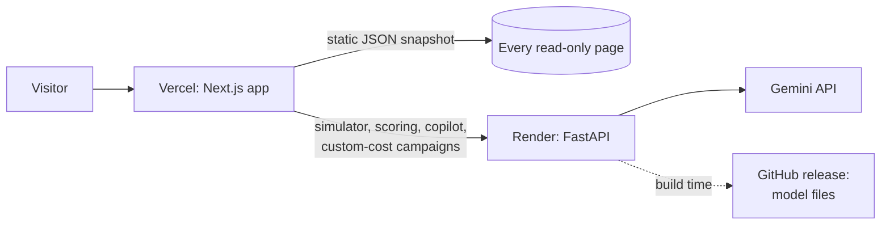

# Deployment

The live demo runs on free tiers with no payment method on file.

| Part | Host | Address |
|---|---|---|
| Web app | Vercel (Hobby plan) | https://lighthouse-retention.vercel.app |
| API | Render (free web service) | https://lighthouse-api-9f2b.onrender.com |
| Model files | GitHub release | [models-v1](https://github.com/ac265640/LightHouse/releases/tag/models-v1) |

## How the pieces fit



- **The web app reads a static snapshot.** `scripts/export_snapshot.py` calls every read-only endpoint and writes the responses to `frontend/public/snapshot/`: the portfolio, map, model report, playbook, monitoring, all 7,043 customer profiles, and campaigns for every $1k budget from $1k to $80k at the default offer costs. Pages load instantly and never wait on the API. The customer list is filtered and sorted in the browser.
- **The API serves only live features:**
  - the what-if simulator
  - CSV scoring
  - campaigns with custom offer costs
  - the Gemini copilot

  The web app pings it on first load so it starts waking while the visitor reads.
- **The API fits a 512 MB instance.** It computes SHAP with LightGBM's built-in TreeSHAP instead of loading the shap library, and peaks at about 400 MB.

## API on Render

1. Sign in at [render.com](https://render.com) with GitHub. No card is needed.
2. Choose **New → Web Service** and select this repository.
3. Use these settings (they match [`deploy/render.yaml`](../deploy/render.yaml)):

   | Setting | Value |
   |---|---|
   | Language | Docker |
   | Branch | `main` |
   | Dockerfile path | `./deploy/Dockerfile.api` |
   | Docker build context | `.` (the repository root) |
   | Instance type | Free |
   | Health check path | `/api/health` |
   | Environment variable | `GEMINI_API_KEY` = your key (optional) |

4. Deploy. The image downloads the model files from the GitHub release and the dataset from Hugging Face, so the first build takes a few minutes.

Render redeploys automatically on every push to `main`. A free instance sleeps after 15 minutes without traffic and takes about a minute to wake.

## Web app on Vercel

```bash
npx vercel login                 # once
cd frontend && npx vercel link   # once: create or select the project
cd .. && deploy/deploy_web.sh    # rebuild the snapshot and deploy to production
```

`deploy/deploy_web.sh` does three things:
1. Exports the snapshot.
2. Builds with `NEXT_PUBLIC_SNAPSHOT=1` and `NEXT_PUBLIC_API_URL` set to the Render address.
3. Uploads the prebuilt output as a single archive, which keeps the 7,000+ snapshot files inside the free plan's upload limit.

To point at a different API, pass its URL:

```bash
deploy/deploy_web.sh https://your-api.example.com
```

## Model files

The trained models (about 40 MB) are kept out of git. To publish a new version after retraining:

```bash
python -m ml.retention.pipeline
gh release create models-v2 artifacts/model.joblib artifacts/customers_scored.parquet
```

Then update `ARTIFACTS_URL` in `deploy/Dockerfile.api`. `artifacts/report.json` stays in git because every documented number comes from it.

## Single container

`deploy/Dockerfile` runs the API and the web app together on port 7860, with Next.js forwarding `/api/*` to the API. It suits any host with about 1 GB of memory:

```bash
docker build -f deploy/Dockerfile -t lighthouse .
docker run -p 7860:7860 -e GEMINI_API_KEY=your-key lighthouse
```

## Keeping it free

- Use only free plans: Vercel Hobby and the Render free instance. Do not add a payment method or upgrade the instance.
- Use a Gemini key from a project without billing (it shows **Free tier** in Google AI Studio). Over-quota requests are then refused rather than charged.
- The API caps copilot usage per visitor, per minute and per day (see [api.md](api.md#ai-copilot)).
- Keep secrets out of git: `GEMINI_API_KEY` lives only in Render's environment settings and in a local `backend/.env`, which is ignored.
